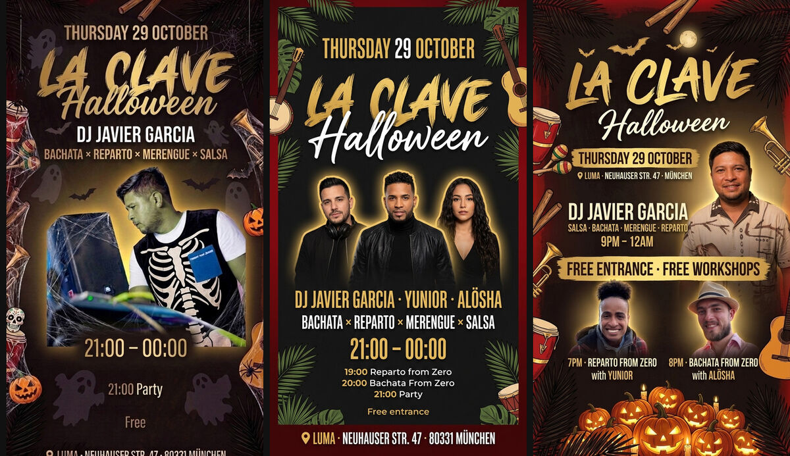
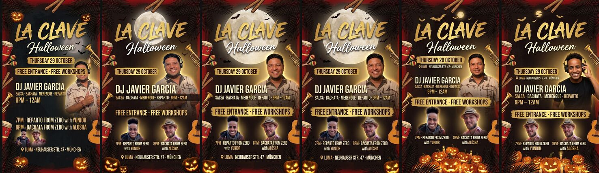

# Why event flyers fail, and what an art-director agent did differently

Started from one organizer's complaint ("this flyer sucks") about the La Clave Halloween flyer
(event `756353f7-afac-4d1f-a07d-95cb598ee17b`, 29 Oct 2026). We reviewed it, traced the prompts,
then ran a spike: Claude acting as art director over the same Gemini painter.

## The evidence

| | Cost | Time | Result |
|---|---|---|---|
| App, one painting | $0.07 | ~9 s | Control run: three strangers' faces, words correct |
| App, the organizer's 27 Oct session | 8 × $0.07 ≈ $0.55 + their time | ~4 min of clicking | Nothing kept |
| Agent (Opus 5.5 directing Gemini, 6 paintings, 30 turns) | $1.29 Claude + $0.46 Gemini ≈ $1.74 | 6 min 44 s | Usable, faces right |

App-wide on 27 Oct: 12 of 52 finished paintings were kept; 30 of 76 painting calls had failed.
The agent's six drafts, with what it found wrong in each, are in
[flyer-agent-spike/agent-result.md](flyer-agent-spike/agent-result.md):

Prompts: the app's ([app-prompt-control.txt](flyer-agent-spike/app-prompt-control.txt)) and the
agent's chosen one ([agent-prompt-v5.txt](flyer-agent-spike/agent-prompt-v5.txt)).

**Confounds — this is one event and one run.** Javier's event photo was swapped minutes after the
27 Oct session, and the workshops are in the data now; the middle flyer is the fair control
(same data as the agent). Nothing here is proven reliable yet.

## What the 27 Oct flyer got wrong, and why

| On the flyer | Cause in the code |
|---|---|
| Bottom third empty; "21:00 Party" and "Free" floating | `textBlock` emits a time badge *and* an agenda line for the same start time; a bare "Free" price line |
| The time is the biggest text, free entry the smallest | The template says "Big time badge" for every event; nothing knows what sells the night |
| Photo pasted as a rectangle, half of it a speaker | The profile photo is used as is; the prompt never says "cut out, no photo background" |
| Fake skeleton costume, green face | Fix note "add costume to dj" on a real person; each fix repaints the last fix, so faces drift |
| Three fixes changed nothing at the bottom | The organizer's note ("don't highlight time") sits in the same prompt as "Big time badge" and "keep the same layout"; the template wins |
| Venue line cut at the bottom edge | No Instagram safe zones in the layout; the read-back reads Gemini's raw image, not the cropped one that's posted |
| Self-contradiction | The saved look says "portrait on the right"; the layout rule says "artists 40–85%, centred" |
| Check said `ok: true` on all 8 | The check verifies spelling only |

## What we learned

1. **Quality comes from judgment in the loop, not from a better prompt.** One templated shot is a
   lottery; the organizer becomes the QA loop and pays in clicks. The desktop-session flyers
   (`~/Local/ikigai/laclave/2026-10-08-*`, 8–12 drafts each) were good because Claude looked at
   every draft and wrote the next prompt for exactly what was wrong.
2. **The spelling check gives false confidence.** It would pass the strangers' faces and the empty
   bottom. Faces, hierarchy and empty space are what make a flyer bad.
3. **Choosing the content matters more than the styling.** The template weighs every field the
   same. The agent picked the reason to come ("FREE ENTRANCE · FREE WORKSHOPS"), dropped noise
   (duplicate start time, postcode), and kept every fact.
4. **Inputs decide a lot.** A smiling portrait instead of a profile shot at the decks changed the
   result more than any prompt edit. The app never checks or chooses photos.
5. **Gemini's behaviour, confirmed:**
   - it ignores layout percentages, but a concrete object filling a zone (the pumpkin pile)
     pushes the text where you want it — the agent found this itself;
   - with several people it swaps or invents faces (agent v6; the app's control run);
   - every edit repaints the picture and faces drift; prefer a fresh painting with a better
     prompt over a chain of edits;
   - costumes on real people look fake; a theme belongs in the scene and the lettering;
   - its text was right in every version — the flyer-studio bet (app composites the words)
     solves a problem that didn't show up here; faces and content choice did.
6. **Cost per *kept* flyer is the number that matters.** The app is ~$0.30 of compute per kept
   flyer at the current keep rate, plus the organizer's time; the agent was $1.74 for one usable
   flyer with no organizer time. One sample only.
7. **The house know-how is the asset.** `~/Orgs/LaClave/assets/flyer-style.md` held what makes a
   good flyer; it should be versioned with the product and grow per organizer.

## Cheap fixes inside the current pipeline (if the agent never ships)

- `textBlock`: drop agenda lines that repeat the start time; "FREE ENTRANCE" instead of "Free";
  the badge goes to the entry/price line, not the time; no postcode in the venue line.
- Fix mode: list only the words, no styling ("Big time badge"), and drop "keep the same layout"
  when the note is about layout or text, so the organizer's note wins.
- Layout: everything important between 14% and 80% of the height; fill the rest with scene.
- Photo: "cut out and blended into the scene, never a rectangle with the photo's background".
- Remove position words from saved look descriptions so they can't fight the layout rule.
- Fixes start from the original painting with all notes so far, not from the last fix.
- Read back the cropped 1080×1920 image, not Gemini's raw output.
- **The urgent one:** multi-person paintings invent faces. Until there is a face check, paint one
  person, or warn.

## The spike

Code on branch `spike/flyer-agent` in `scripts/flyer-agent/` (not used by the app):

- `brief.ts` — event → facts as data, plus every photo and the style reference on disk
- `tools.ts` — `paint` / `read` / `fit` over Gemini, each call's cost logged to `calls.jsonl`
- `art-director.md` — the agent's instructions: house recipe, Gemini's failures, checklist
- `run.sh` — one run: `claude -p` (headless) directs, Bash runs the tools, budget 8 paintings
- `control.ts` — the app's own `paintPrompt` on the same brief, for a fair comparison

Run it: `DATABASE_URL=… GEMINI_API_KEY=… scripts/flyer-agent/run.sh <eventId> <runDir> [model]`.
Full run output (all drafts, prompts, logs): `~/Local/ikigai/wedance/flyer-agent-spike/la-clave-halloween/`.

## Open questions

- Does Sonnet 5.5 as director reach the same quality at a fraction of the $1.29?
- How reliable is it across 5–10 different events (festival line-ups, no-photo events, workshops)?
- Where would it run: past Vercel's 300 s limit, so a queue, Claude Managed Agents, or Hetzner?
